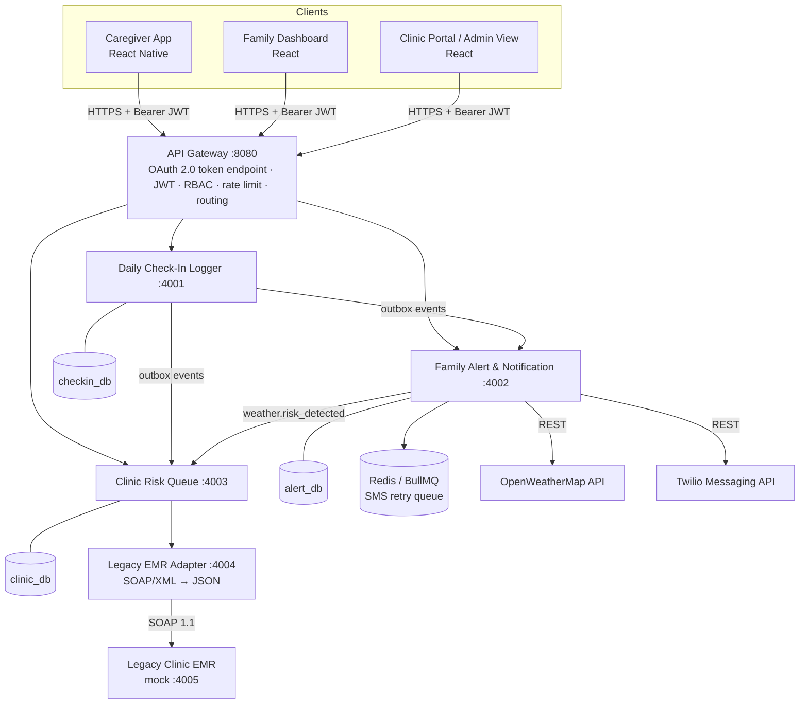

# ElderCare Connect

Integrated community-based elderly health monitoring and emergency response platform
(TIP Manila · Systems Integration and Architecture 1 · IT31S1 Group 6).

Node.js + Express microservices behind an API Gateway, PostgreSQL per service, OAuth 2.0/JWT + RBAC,
OpenWeatherMap × patient-profile mashup, Twilio SMS with retry queue, and a SOAP/XML adapter for
legacy RHU clinic EMRs. React web dashboards and a React Native caregiver app are included.

### Documentation
- `docs/PROPOSAL_TRACEABILITY.md` – every proposal section mapped to code and verification evidence
- `docs/SUBMISSION_GUIDE.md` – frontend, cloud deployment, middleware data flows (with measured results), JMeter, CI/CD, demo script
- `testing/README.md` – Postman, SoapUI, JMeter and failure-test commands

### Verified results (local run: PostgreSQL 16, Redis 7, all six services)
| Check | Result |
|---|---|
| Unit tests | 38 / 38 passing |
| End-to-end smoke test | 21 / 21 passing |
| Check-in → family alert → clinic queue | **~170 ms** (objective ≤ 2.0 s) |
| Alert service down during a check-in | check-in accepted; event delivered automatically after restart |
| Heatwave (heat index 46.8 °C) / typhoon (24 m/s) | correct at-risk patients warned; P1 / P2 triage items created |
| OpenWeatherMap unreachable | stale cached data used, outage logged |
| Twilio unreachable | BullMQ retried with backoff, marked failed, in-app alert kept |
| Forged Twilio webhook | rejected (403) |

### Where the Section 10 / 11 / 12 deliverables live
| Task | Files |
|---|---|
| 1 · API Gateway & security | `api-gateway/server.js`, `api-gateway/src/middleware/authMiddleware.js`, `api-gateway/src/middleware/roleMiddleware.js`, `api-gateway/src/routes/oauth.js`, `api-gateway/src/auth/*` |
| 2 · API routing contracts | `api-gateway/src/routes/index.js`, `api-gateway/src/lib/proxy.js` |
| 3 · Weather × Twilio mashup | `services/alert-service/src/weatherAlertMashup.js`, `weatherRisk.js`, `twilioClient.js`, `smsQueue.js` |
| Legacy SOAP/XML adapter | `services/legacy-emr-adapter/` (+ mock EMR and WSDL in `services/mock-legacy-emr/`) |

---

## 1. Architecture



| Component | Folder | Owns |
|---|---|---|
| API Gateway | `api-gateway/` | Nothing persistent – auth, RBAC, routing |
| Daily Check-In Logger | `services/checkin-service/` | patients, check-ins, vital trends, baselines, outbox |
| Family Alert & Notification | `services/alert-service/` | alert rules, alerts, notification logs, subscribers, weather cache |
| Clinic Risk Queue | `services/clinic-risk-service/` | risk scores, triage items, follow-up actions |
| Legacy EMR Adapter | `services/legacy-emr-adapter/` | none (stateless translator) |
| Mock Legacy EMR | `services/mock-legacy-emr/` | demo data for SoapUI / dev (zero dependencies) |
| Web dashboards | `frontend/web/` | React (Vite) – caregiver, family, clinic, admin views |
| Caregiver mobile | `frontend/mobile/` | React Native (Expo), offline-first check-ins |
| Test assets | `testing/` | Postman, JMeter, SoapUI |

**Data ownership rule:** each service talks only to its own database. Cross-service data moves over
REST (`/internal/*` endpoints) or events – never by reading another service's tables.

### The Check-in → Alert → Clinic Queue saga (Section 15)
1. Caregiver `POST /api/checkins` → gateway validates JWT, role `caregiver`, and that the patient is in the token's `patients` claim.
2. Check-in service validates vitals, runs anomaly detection, and in **one DB transaction** stores the check-in **and** an outbox event per target.
3. The outbox dispatcher immediately delivers `checkin.anomaly_detected` to the Alert and Clinic services (exponential backoff on failure, marked `failed` after 10 attempts for manual follow-up – never silently dropped).
4. Alert service writes the in-app alert and enqueues one SMS per subscriber (BullMQ → Twilio, retry with backoff; in-app alert is the fallback channel).
5. Clinic service upserts the patient's single active triage item and recomputes the weighted score/priority.
Both consumers are idempotent on `eventId`, so at-least-once delivery is safe. Typical end-to-end time is well under the 2.0 s target.

---

## 2. Quick start (Docker – recommended)

Requirements: Docker Desktop (or Docker Engine + Compose v2).

```bash
cp .env.example .env
# edit .env: set strong JWT_SECRET, JWT_REFRESH_SECRET, INTERNAL_SERVICE_TOKEN
#            optionally OPENWEATHER_API_KEY and TWILIO_* (SMS stays in dry-run until SMS_DRY_RUN=false)
docker compose up --build
```

Gateway: <http://localhost:8080> · Mock EMR WSDL: <http://localhost:4005/emr?wsdl>

Smoke test:
```bash
TOKEN=$(curl -s localhost:8080/oauth/token -H 'Content-Type: application/json' \
  -d '{"grant_type":"password","username":"caregiver.maria","password":"ElderCare@2026"}' | node -pe 'JSON.parse(require("fs").readFileSync(0)).access_token')

curl -s localhost:8080/api/checkins -H "Authorization: Bearer $TOKEN" -H 'Content-Type: application/json' \
  -d '{"patientId":"P-1001","vitals":{"systolic":186,"diastolic":118,"heartRate":104},"medication":{"taken":false}}'
```

Web dashboards:
```bash
cd frontend/web && npm install && npm run dev      # http://localhost:3000 (proxies /api and /oauth to :8080)
```
Caregiver app (Expo Go on your phone): set `expo.extra.apiBaseUrl` in `frontend/mobile/app.json` to your computer's LAN IP, then `cd frontend/mobile && npm install && npx expo start`.

### Demo accounts (password `ElderCare@2026` – change before any real use)
| Username | Role | Patients |
|---|---|---|
| `caregiver.maria` | caregiver | P-1001, P-1002 |
| `family.jose` | family_member | P-1001 |
| `nurse.ana` | clinic_staff | all |
| `admin.harold` | system_admin | all |

Users live in `api-gateway/data/users.json` with scrypt hashes. New hash: `node api-gateway/scripts/hash-password.js "NewPassword"`.

---

## 3. Running without Docker (Windows / macOS / Linux)

You need Node 18+ and PostgreSQL 14+. Redis is optional; without it the SMS retry queue runs in memory.

```powershell
# 1. create the three databases (psql, pgAdmin, or:)
createdb -U postgres checkin_db
createdb -U postgres alert_db
createdb -U postgres clinic_db

# 2. from the project root: generate every .env and install all backend packages
node scripts/setup-local.js "YourPostgresPassword"
npm run install:all
```
`setup-local.js` creates all five `.env` files with:
- one shared, freshly generated `INTERNAL_SERVICE_TOKEN`
- random JWT secrets
- `DATABASE_URL`s for `localhost:5432` (special characters in the password are encoded for you)
- `REDIS_URL` blank and `SMS_DRY_RUN=true`

Re-run it with `--force` to regenerate. Use `--db-port`, `--db-user` or `--redis redis://localhost:6379` if your setup differs.

```powershell
# 3. start each service in its own terminal tab (order matters only for the first log lines)
cd services\mock-legacy-emr;     node server.js   # :4005
cd services\legacy-emr-adapter;  npm start        # :4004
cd services\clinic-risk-service; npm start        # :4003
cd services\alert-service;       npm start        # :4002
cd services\checkin-service;     npm start        # :4001
cd api-gateway;                  npm start        # :8080

# 4. verify (new tab, project root)
npm test          # 38 unit tests
npm run smoke     # 21 end-to-end checks through the gateway
```
Each service creates its own tables (and demo data) on first start.

If PowerShell refuses to run `npm` ("running scripts is disabled"), run this once and reopen the terminal: `Set-ExecutionPolicy -Scope CurrentUser RemoteSigned`.

---

## 4. API reference (public, via the gateway)

All `/api/*` routes need `Authorization: Bearer <access_token>`.

| Method | Path | Roles | Service | Notes |
|---|---|---|---|---|
| POST | `/oauth/token` | public | gateway | `grant_type=password` or `refresh_token` (RFC 6749) |
| POST | `/api/checkins` | caregiver (assigned patient) | Check-In | 201 + anomalies; 422 validation; `idempotencyKey` for offline replay |
| GET | `/api/patients/:id/history?days=30&limit=100` | caregiver, family (own), clinic, admin | Check-In | check-ins + trends + baseline |
| GET | `/api/patients/:id` | same as above | Check-In | profile |
| POST | `/api/alerts/dispatch` | clinic, admin | Alert | `{patientId, message, severity?, title?, channels?}` → 202 |
| GET | `/api/alerts/notifications?patientId=` | family, caregiver | Alert | in-app alert feed for own patients |
| POST | `/api/alerts/weather-check` | clinic, admin | Alert | run weather mashup now (`{zipCode?}`) |
| GET | `/api/clinic/queue?status=&priority=&clinic=` | clinic, admin | Clinic | prioritised triage queue |
| PATCH | `/api/clinic/queue/:itemId` | clinic | Clinic | `{status?, notes?, assignedTo?}` with transition rules |
| GET | `/api/clinic/patients/:id/emr-history` | clinic, admin | Clinic → Adapter → SOAP EMR | translated legacy history; boosts risk score |
| GET | `/api/admin/health` | admin | gateway | health of every service + circuit breakers |
| GET | `/api/admin/users` | admin | gateway | user accounts and roles (never password hashes) |
| POST | `/webhooks/twilio/status` | Twilio (signature-verified) | Alert | SMS delivery receipts |
| POST | `/webhooks/twilio/inbound` | Twilio (signature-verified) | Alert → Check-In | **SMS check-in** for caregivers without internet: `CHECKIN P-1001 BP 150/90 HR 80 MED Y` |

Example check-in body:
```json
{
  "patientId": "P-1001",
  "idempotencyKey": "mob-5b1c...",
  "recordedAt": "2026-10-10T07:30:00+08:00",
  "vitals": { "systolic": 150, "diastolic": 92, "heartRate": 80, "temperatureC": 36.8, "spo2": 96, "bloodGlucose": 140 },
  "medication": { "taken": false, "missed": ["Losartan"] },
  "mobilityStatus": "normal",
  "mood": "neutral",
  "notes": "Slept poorly"
}
```

Errors are JSON: `{ "error": "<code>", "message": "..." }` (+ `details[]` for 422, `requestId` for 5xx).
Every response carries `X-Request-Id`, which appears in every service's structured logs.

---

## 5. Security (Section 12)

- **OAuth 2.0 + JWT:** short-lived access tokens (15 min default) and refresh tokens signed with a separate secret. HS256 by default; set `JWT_ALGORITHM=RS256` + `JWT_PUBLIC_KEY` to verify tokens from an external IdP (Keycloak, Auth0, Cognito).
- **Strict verification:** algorithm whitelist (blocks `alg=none`), issuer, audience, expiry, token type (`refresh` tokens can't call APIs), known role.
- **RBAC at the gateway** (`roleMiddleware.js`) + **patient scoping** for caregivers/families from the `patients` claim. Services re-check scope as defence in depth.
- **Internal trust:** services accept requests only with `X-Internal-Token`; client-supplied `X-User-*` headers are stripped and replaced by the gateway.
- **Brute-force protection:** 20 failed logins / 15 min per IP; 300 API requests / min per IP (tune `RATE_LIMIT_*`).
- **Secrets only in env vars:** `OPENWEATHER_API_KEY`, `TWILIO_*`, JWT secrets, DB passwords. `.env` is git-ignored. Logs redact `authorization`, `password`, `token`, `phone`, `appid`.
- **Transport/at rest:** terminate TLS at the load balancer in front of the gateway; set `DB_SSL=true` for managed Postgres (e.g. AWS RDS with storage encryption = AES-256).
- **Helmet** security headers and CORS allow-list (`CORS_ORIGINS`).

---

## 6. Weather mashup (Section 11)

`services/alert-service/src/weatherAlertMashup.js`

1. Every `WEATHER_POLL_INTERVAL_MINUTES` the alert service asks the check-in service for the distinct monitored zip codes.
2. `fetchWeatherByZip(zip, 'PH')` calls OpenWeatherMap current weather (falls back to patient coordinates if OWM has no record for the zip; optional One Call 3.0 advisories with `OPENWEATHER_ONECALL_ENABLED=true`).
3. The response is normalised into an internal risk profile; heat index = max(OWM `feels_like`, NOAA heat index from temp + humidity).
4. **Heat:** heat index **> 40 °C** → patients in that zip with hypertension / cardiovascular / diabetes / kidney disease / COPD get a dehydration-warning SMS (once per patient per day) **and** a preventive Clinic Risk Queue item.
5. **Storm:** typhoon/storm advisory, severe condition code, or wind ≥ 17.2 m/s → mobility-restricted patients get an evacuation-prep SMS and a triage item.
6. **Resilience:** results cached per zip for 60 min (rate limits); if OWM is down, the last cached data up to 24 h old is used and the outage is logged.

Try it without a database:
```bash
cd services/alert-service && npm install
OPENWEATHER_API_KEY=xxx node src/weatherAlertMashup.js --zip 1012 --country PH
OPENWEATHER_API_KEY=xxx TWILIO_ACCOUNT_SID=AC... TWILIO_AUTH_TOKEN=... TWILIO_FROM_NUMBER=+1... \
  node src/weatherAlertMashup.js --zip 1012 --country PH --threshold 30 --send-to +63917XXXXXXX
```

---

## 7. Failure handling

| Failure | Behaviour |
|---|---|
| Twilio down / carrier error | SMS job retried with exponential backoff (5 attempts); permanent errors (invalid / opted-out number) stop immediately; in-app alert already delivered |
| OpenWeatherMap down | stale cache (≤ 24 h) used, outage logged; health endpoint shows last fetch |
| Alert or Clinic service down | check-in still succeeds (201); outbox retries delivery until the service returns |
| Any service slow/down behind gateway | per-service circuit breaker → fast 503 instead of hung requests; GETs retried, POSTs never auto-retried |
| Legacy EMR down / slow | adapter returns 502/503; clinic queue keeps working without EMR enrichment |
| Duplicate event delivery | consumers de-duplicate on `eventId` |
| Phone offline (rural) | mobile app stores check-ins locally and syncs later; `idempotencyKey` prevents duplicates |
| No mobile data at all | caregiver texts the check-in by SMS; Twilio's webhook creates it and replies with the result |

Simulate: `docker compose stop alert-service`, submit a critical check-in, restart it, watch the outbox deliver.
Slow EMR: `MOCK_EMR_DELAY_MS=8000 docker compose up -d mock-legacy-emr`.

---

## 8. Testing (Section 13)

| Layer | Tool | Asset |
|---|---|---|
| Unit | `node --test` | `*/test/*.test.js` – 38 tests: vitals validation, anomaly rules, heat index, risk scoring, SMS parsing, EMR mapping, gateway auth/RBAC |
| End-to-end smoke | Node script | `testing/e2e-smoke.mjs` (`npm run smoke`) – 21 checks through the gateway |
| Weather demo / failure | fake OpenWeatherMap | `testing/mocks/fake-openweathermap.js` – heatwave + typhoon on demand, no API key |
| Functional + security | Postman | `testing/postman/ElderCare_Connect.postman_collection.json` (folders 0–4) |
| Integration (saga) | Postman / Newman | folder **5. Integration** – check-in → family alert → clinic queue → EMR history → triage update |
| Legacy SOAP | SoapUI | `testing/soapui/ElderCare_Legacy_EMR-soapui-project.xml` |
| Load / stress | JMeter | `testing/jmeter/ElderCare_Connect_Load_Stress.jmx` |

See `testing/README.md` for exact commands.

---

## 9. Configuration reference

Every service has a `.env.example`. Most important:

| Variable | Where | Purpose |
|---|---|---|
| `JWT_SECRET`, `JWT_REFRESH_SECRET` | gateway | token signing (≥ 32 random chars) |
| `INTERNAL_SERVICE_TOKEN` | all | gateway ↔ service trust (same value everywhere) |
| `DATABASE_URL` | checkin, alert, clinic | own PostgreSQL database |
| `OPENWEATHER_API_KEY` | alert | weather mashup |
| `TWILIO_ACCOUNT_SID`, `TWILIO_AUTH_TOKEN`, `TWILIO_FROM_NUMBER` / `TWILIO_MESSAGING_SERVICE_SID` | alert | SMS |
| `SMS_DRY_RUN` | alert | `true` = log instead of send |
| `REDIS_URL` | alert | durable BullMQ queue (empty = in-memory) |
| `HEAT_INDEX_THRESHOLD_C` | alert | default 40 |
| `LEGACY_EMR_URL` | adapter | partner RHU SOAP endpoint |
| `ANOMALY_*` | checkin | clinical thresholds – have the partner RHU physician approve them |

---

## 10. Deploying to the cloud (Section 14)

Single VM (EC2 / Azure VM / GCP): `docker compose -f docker-compose.yml -f docker-compose.cloud.yml up -d --build`. Only the gateway is exposed (on 127.0.0.1, behind a TLS proxy); databases, Redis and internal services stay private. Full walkthrough: `docs/SUBMISSION_GUIDE.md` §2.

Managed AWS outline:

- Build/push each image to ECR; run each as an ECS Fargate service (2+ tasks each for availability).
- Only the gateway sits behind a public Application Load Balancer (HTTPS via ACM). Services live in private subnets and reach each other through ECS Service Connect / Cloud Map names (`http://checkin-service:4001`, …).
- Three RDS PostgreSQL instances (or three databases on one instance for a student budget), `DB_SSL=true`, encryption at rest on.
- ElastiCache Redis for BullMQ. Secrets in AWS Secrets Manager injected as env vars.
- Point `TWILIO_STATUS_CALLBACK_URL` at `https://<your-domain>/webhooks/twilio/status`.

---

## 11. Troubleshooting

| Symptom | Fix |
|---|---|
| `Missing required environment variable` on start | copy `.env.example` to `.env` and fill it in |
| 401 `invalid_token` | token expired (15 min) → use refresh grant; or gateway restarted with a different `JWT_SECRET` |
| 403 from gateway | role not allowed, or patient not in your token's `patients` claim |
| 401 `Missing or invalid internal service token` from a service | `INTERNAL_SERVICE_TOKEN` differs between gateway and service |
| 429 during JMeter runs | raise `RATE_LIMIT_MAX` for the test |
| SMS not arriving | `SMS_DRY_RUN=true` (default), Twilio trial can only text verified numbers, number must be E.164 (`+63917…`) |
| `weather-check` returns 503 | `OPENWEATHER_API_KEY` not set (new keys can take up to 2 h to activate) |
| Clinic queue empty after a check-in | check `GET /api/admin/health` → checkin `outbox` counts; `pending` means the alert/clinic service was unreachable |

## Disclaimer
Anomaly thresholds and risk weights are screening heuristics for a student prototype, not a medical device.
Clinical rules must be validated by licensed clinicians before real-world use, and real deployments must
comply with the Philippine Data Privacy Act (RA 10173) – including a privacy impact assessment and consent
for every SMS recipient.
